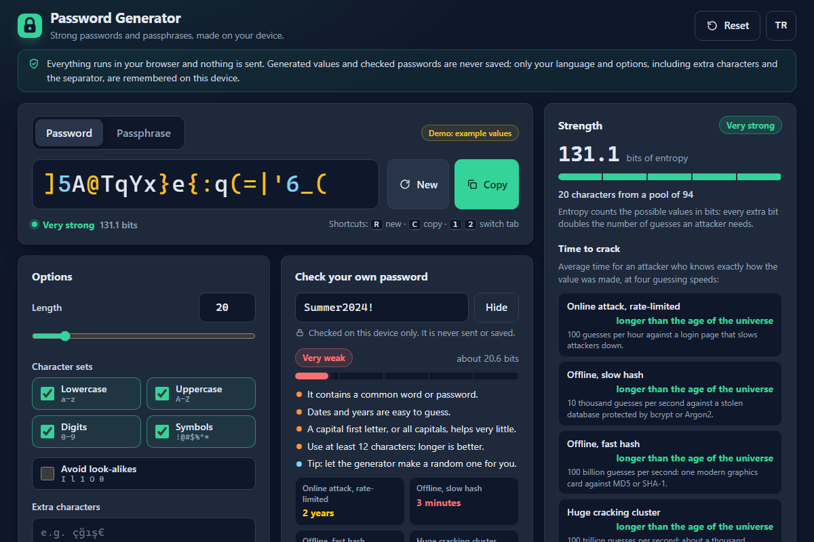

# Password Generator - strong passwords and passphrases made in your browser, with an honest strength meter

[](#tests)
[](LICENSE)

**▶ Open the app: https://celaldrg.github.io/password-generator/**



Nothing you generate or type leaves the page. There is no server, no analytics and no network request after
the page loads (a strict Content Security Policy blocks them). Only your language and options are kept in
`localStorage`, including the extra characters and the passphrase separator you type in them; generated values
and checked passwords are never stored.

## Features

- **Passwords** of 4 to 128 characters from lowercase, uppercase, digits and the 32 ASCII symbols, plus up to
  64 extra characters of your own (for example `çğış€`). Every selected set appears at least once, and every
  such password is equally likely.
- **Avoid look-alikes** removes `I l 1 O 0` from the pool.
- **Passphrases** of 3 to 12 words from an English (1,901 words) or Turkish (1,473 words) list, with your
  separator, lowercase / Capitalized / UPPERCASE / random capitals and an optional random digit.
- **Unbiased randomness**: `crypto.getRandomValues` with rejection sampling, so no character or word is
  favoured (checked with a chi-square test).
- **Entropy meter** in bits with a five-step label (very weak to very strong) and a sentence that says where
  the number comes from, such as "20 characters from a pool of 94".
- **Crack times** at four guessing speeds, each explained: a rate-limited online attack (100 guesses per
  hour), a stolen database with a slow hash such as bcrypt (10 thousand per second), a fast hash such as MD5
  on one graphics card (100 billion per second) and a huge cluster (100 trillion per second).
- **Check your own password** (with show / hide): spots common and famous passwords, English and Turkish
  words and first names, keyboard runs, sequences, repeats, dates, `@`-for-`a` swaps, reversed words and
  capital-letter habits, then gives plain advice for every score. The check runs on your device only.
- **Last 10 values** in memory only, each with its own copy button. Reloading the page forgets them.
- **Copy** with the Clipboard API, with a fallback for older browsers.
- **English and Turkish** interface; the choice is remembered.
- Mobile first: works from 375 px wide, large tap targets, swipe for a new value.

## How to use

1. Pick **Password** or **Passphrase** at the top.
2. Set the length (slider or number field), the character sets and the other options. Every change makes a
   new value at once; while you drag a slider or type extra characters or a separator, the history keeps only
   the value you stop at.
3. Press **Copy**, or **New** for another value. The strength panel shows the entropy and the crack times.
4. To test a password you already use, type it into **Check your own password**. It never leaves the page.

**Keyboard**

| Key | Action |
| --- | --- |
| `R` | new value |
| `C` | copy the value |
| `1` / `2` | Password / Passphrase |
| `←` `→` `Home` `End` | move between the two tabs when one has focus |
| `Tab` | move through all controls |

Shortcuts are ignored while you type in a field and when Ctrl, Cmd or Alt is held, so normal copy and paste
keep working.

**Touch**: tap **New** and **Copy**, or swipe the value sideways for a new one. Vertical swipes scroll the
page as usual. **Reset** in the header restores the default options and clears the history and the checker.

Add `?demo` to the address for a fixed example screen (used for the screenshot): a 20-character password, its
entropy and the checker with a weak example. Values generated after that come from the secure source again.

## Run locally

There is no build step and there are no dependencies. Serve the folder with any static server, for example:

```sh
npx serve .
```

Then open the address it prints. ES modules need `http://`; opening `index.html` as a `file://` page does not
work.

## Tests

```sh
node --test
```

Node 22 or newer, no packages to install. The tests are deterministic (seeded random sources) and cover:

- unbiased random integers and the seeded source: the rejection boundary is tested directly, because the bias
  of plain 32-bit modulo (about 1 in 69 million) is far too small for a sample to show, and chi-square
  uniformity checks catch coarser bias such as a byte modulo;
- password and passphrase generation, option limits, look-alikes, custom characters and Turkish capitals;
- entropy, strength levels, crack times and the wording of durations;
- the strength checker: common and famous passwords, words and names, keyboard runs, sequences, repeats,
  dates, swaps, and advice for every score;
- app state: history limit, previews kept out of the history until they settle, reset, saved settings that
  never contain a value, the `?demo` screen;
- storage that survives broken or blocked `localStorage`;
- both languages having every key, and every key the page and the UI code use;
- display and input helpers: meter fill, colour tones, shortcuts, swipes and tab keys;
- the page itself: required head tags, ids wired to the code, no external requests, no inline code, no
  `innerHTML`, `eval` or `console`.

## Project structure

```
index.html            page markup with English fallback text
style.css             dark theme, mobile-first layout
src/
  main.js             UI entry: events and rendering
  view.js             DOM helpers (textContent only)
  clipboard.js        copy with the Clipboard API and a fallback
  app.js              app state: options, value, history, demo
  password.js         password generator
  passphrase.js       passphrase generator
  words-en.js         English word list
  words-tr.js         Turkish word list
  random.js           crypto and seeded random sources, unbiased sampling
  entropy.js          entropy, strength levels, crack times
  strength.js         checker for passwords people type
  common-passwords.js common passwords for the checker
  common-words.js     common words and first names for the checker
  display.js          meter fill, tones, text size (no DOM)
  input.js            shortcuts, swipes, tab keys (no DOM)
  i18n.js             English and Turkish strings, number formats
  storage.js          localStorage wrapper (language and options only)
  validate.js         helpers that clean up untrusted input
test/                 node:test suites
docs/screenshot.png   screenshot of the ?demo screen
```

## License

[MIT](LICENSE) © 2026 Celalettin Durgaç

## Türkçe

**▶ Uygulamayı aç: https://celaldrg.github.io/password-generator/**

Tarayıcınızda çalışan bir parola ve parola cümlesi üreticisi. Ürettiğiniz ya da yazdığınız hiçbir şey sayfadan
çıkmaz: sunucu yok, analitik yok, sayfa yüklendikten sonra hiçbir ağ isteği yapılmaz (katı bir Content Security
Policy bunları engeller). `localStorage` içinde yalnızca dil ve seçenekleriniz tutulur, bunlara yazdığınız ek
karakterler ve parola cümlesi ayracı da dahil; üretilen değerler ve denetlenen parolalar asla kaydedilmez.

### Özellikler

- **Parolalar**: küçük harf, büyük harf, rakam ve 32 ASCII sembolden 4 ile 128 karakter arası; isterseniz
  64 karaktere kadar kendi karakterleriniz (örneğin `çğış€`). Seçili her kümeden en az bir karakter bulunur ve
  bu koşula uyan her parola eşit olasılıklıdır.
- **Benzer karakterleri çıkar**: `I l 1 O 0` havuzdan çıkarılır.
- **Parola cümleleri**: İngilizce (1.901 kelime) ya da Türkçe (1.473 kelime) listeden 3 ile 12 kelime; ayraç,
  küçük / Baş harf büyük / BÜYÜK / rastgele büyük harf ve isteğe bağlı rastgele bir rakam.
- **Yansız rastgelelik**: reddetme örneklemeli `crypto.getRandomValues`; hiçbir karakter ya da kelime kayırılmaz
  (ki-kare testiyle denetlenir).
- **Entropi göstergesi**: bit cinsinden değer, beş basamaklı etiket ve sayının nereden geldiğini anlatan bir
  cümle ("94 karakterlik havuzdan 20 karakter" gibi).
- **Kırılma süreleri**: dört tahmin hızında, her biri açıklamalı: sınırlı çevrim içi saldırı (saatte 100
  tahmin), bcrypt gibi yavaş hash'li çalıntı veritabanı (saniyede 10 bin), tek ekran kartıyla MD5 gibi hızlı
  hash (saniyede 100 milyar) ve dev bir küme (saniyede 100 trilyon).
- **Kendi parolanızı denetleyin** (göster / gizle): yaygın ve ünlü parolaları, İngilizce ve Türkçe kelimeleri
  ve kişi adlarını, klavye dizilerini, sıraları, tekrarları, tarihleri, `a` yerine `@` gibi değişiklikleri, ters
  kelimeleri ve büyük harf alışkanlıklarını bulur, her güç düzeyi için sade öneriler verir. Denetim yalnızca
  cihazınızda yapılır.
- **Son 10 değer** yalnızca bellekte, her birinin kendi kopyalama düğmesiyle. Sayfa yenilenince silinir.
- **Kopyalama**: Clipboard API, eski tarayıcılar için yedek yöntemle.
- **Türkçe ve İngilizce** arayüz; seçim hatırlanır.
- Önce mobil: 375 px genişlikten itibaren çalışır, büyük dokunma alanları, yeni değer için kaydırma.

### Nasıl kullanılır

1. Üstten **Parola** ya da **Parola cümlesi** seçin.
2. Uzunluğu (kaydırıcı ya da sayı alanı), karakter kümelerini ve diğer seçenekleri ayarlayın. Her değişiklik
   hemen yeni bir değer üretir; kaydırıcıyı sürüklerken ya da ek karakter veya ayraç yazarken geçmişe yalnızca
   durduğunuz değer eklenir.
3. **Kopyala**'ya basın ya da başka bir değer için **Yeni**'ye. Güç paneli entropiyi ve kırılma sürelerini
   gösterir.
4. Kullandığınız bir parolayı denemek için **Kendi parolanızı denetleyin** alanına yazın. Parola sayfadan çıkmaz.

**Klavye**: `R` yeni değer, `C` kopyala, `1` / `2` Parola / Parola cümlesi, sekmelerden biri odaktayken
`←` `→` `Home` `End` sekmeler arasında gezinir, `Tab` tüm denetimlerde dolaşır. Bir alana yazarken ve Ctrl,
Cmd ya da Alt basılıyken kısayollar çalışmaz; olağan kopyala-yapıştır bozulmaz.

**Dokunmatik**: **Yeni** ve **Kopyala**'ya dokunun ya da yeni değer için değeri yana kaydırın. Dikey kaydırma
sayfayı her zamanki gibi kaydırır. Üstteki **Sıfırla** varsayılan seçeneklere döner, geçmişi ve denetleyiciyi
temizler.

Adrese `?demo` eklerseniz sabit bir örnek ekran açılır (ekran görüntüsü için): 20 karakterlik bir parola,
entropisi ve zayıf bir örnekle denetleyici. Sonradan üretilen değerler yine güvenli kaynaktan gelir.

### Yerelde çalıştırma

Derleme adımı ve bağımlılık yoktur. Klasörü herhangi bir statik sunucuyla açın, örneğin:

```sh
npx serve .
```

Sonra yazdığı adresi açın. ES modülleri `http://` ister; `index.html` dosyasını `file://` olarak açmak
çalışmaz.

### Testler

```sh
node --test
```

Node 22 ya da üstü yeterli, kurulacak paket yok. Testler belirlenimcidir (tohumlu rastgele kaynak) ve şunları
kapsar: yansız rastgele sayılar (reddetme sınırı doğrudan sınanır, çünkü düz 32 bit mod yanlılığı yaklaşık
69 milyonda 1'dir ve hiçbir örneklemde görünmez; ki-kare tekdüzelik testleri bayt modu gibi kaba yanlılığı
yakalar); parola ve parola cümlesi üretimi, seçenek sınırları, benzer karakterler, özel karakterler ve Türkçe
büyük harfler; entropi, güç seviyeleri, kırılma süreleri ve sürelerin yazımı; parola denetleyicisi (ünlü
parolalar, kişi adları, her güç düzeyine öneri); uygulama durumu (geçmiş sınırı, oturana kadar geçmişe
girmeyen önizlemeler, sıfırlama, değer içermeyen kayıtlı ayarlar, `?demo` ekranı); bozuk ya da engelli `localStorage`; iki dilde de her anahtarın bulunması;
gösterge, kısayol, kaydırma ve sekme yardımcıları; sayfanın kendisi (zorunlu etiketler, koda bağlı kimlikler,
dış istek ve satır içi kod olmaması).

### Lisans

[MIT](LICENSE) © 2026 Celalettin Durgaç
